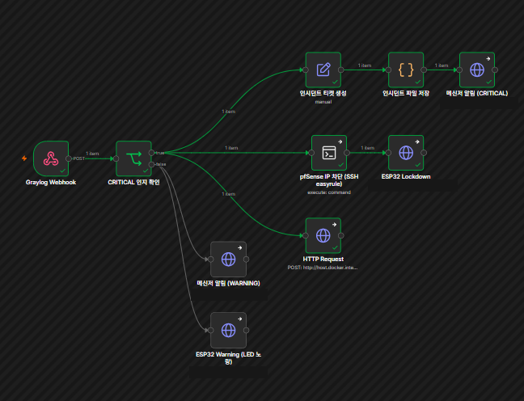
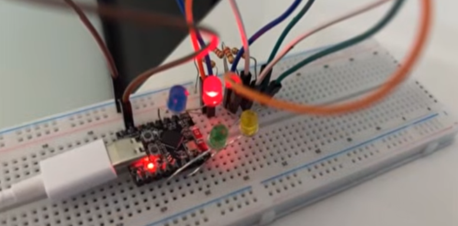
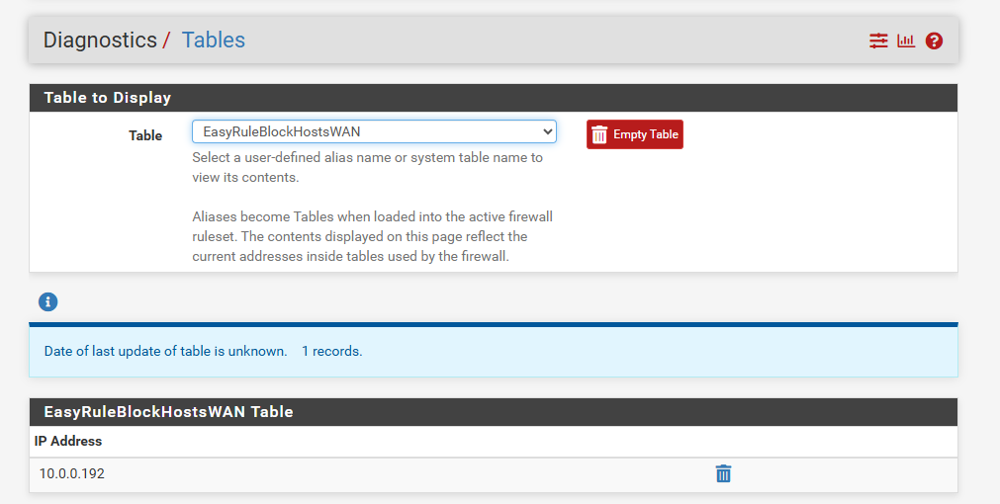
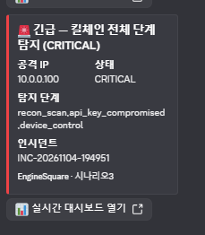
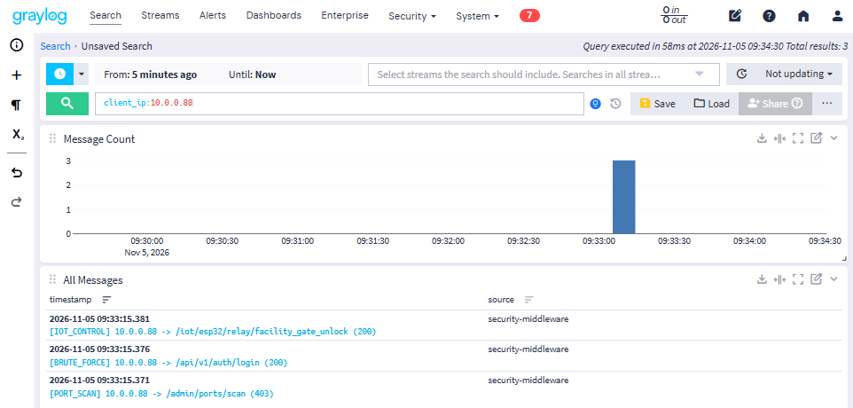
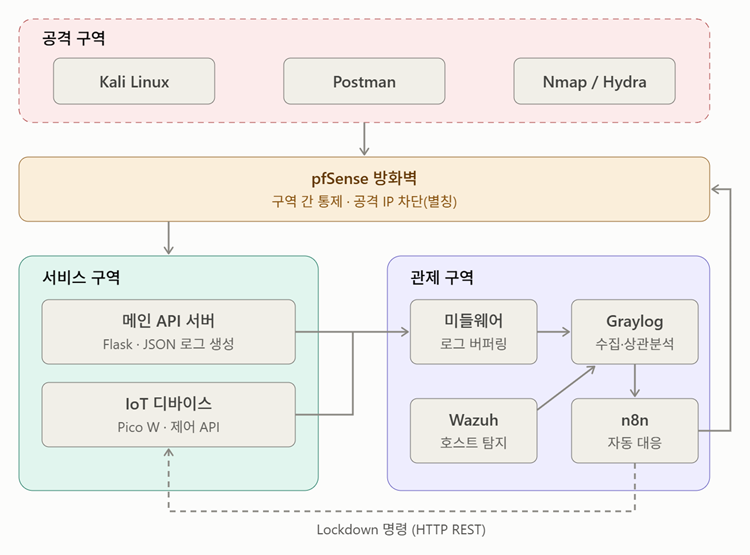
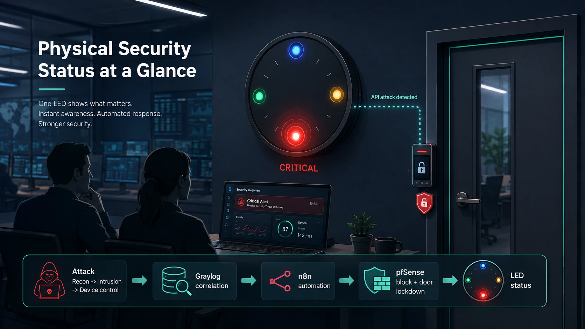

# EngineSquare 통합 보안 관제 — 킬체인 상관분석과 IoT 대응

**소속 / 기간** SKT ALEPH 1기 팀 프로젝트 (3인, 팀장) · 2026
**최종 성과** 같은 공격자 IP에서 정찰·인증 공격·장치 제어가 10분 안에 3종 이상 모이면 자동으로 CRITICAL로 판정하고, pfSense 차단·ESP32 LED Lockdown·대시보드 티켓·디스코드 봇 알림까지 사람 손 없이 연결
**사용 기술** Graylog, n8n, pfSense, ESP32-C3 (MicroPython), Flask·MySQL, Discord Bot, Docker

## 문제
공격은 포트 스캔, 무차별 대입, 유출 키 재사용, 비정상 장비 제어처럼 단계마다 따로 보이면 애매한 이벤트입니다. 시스템별로 로그가 흩어져 있으면 "지금 공격이 진행 중인지"를 알기 어렵습니다. 또 보안 회사에는 공격이 계속 들어오는데, 대시보드와 메시지 알림이 이미 많아도 가장 직관적인 방법은 벽에 걸린 시계처럼 상태가 한눈에 보이는 것이라고 생각했습니다. 공격은 온라인에만 오지 않고 출입문 같은 물리 장치에도 API 공격이 올 수 있어, 이를 바로 감지해 물리적으로 보여주는 IoT 시스템을 만들고 싶었습니다.

## 나의 역할
3인 팀의 팀장으로 시나리오3(킬체인 상관분석·IoT)을 전담했고, 팀의 통합 보고서 취합과 회의록 작성을 맡았습니다. (시나리오1 로그 버퍼링 Middleware와 시나리오2 유출 API 키 탐지·공용 웹앱은 팀원이 담당했고, 제 파트는 이들이 만든 이벤트를 이어서 판단하고 대응하는 계층입니다.)

- Graylog Event Definition으로 `client_ip` 기준 상관분석 규칙(CRITICAL/WARNING) 설계
- n8n 자동 대응 워크플로우(pfSense 차단, ESP32 Lockdown, 대시보드 티켓, 디스코드 봇 알림) 구현
- ESP32-C3에 LED 4색을 붙인 독립형 HTTP 서버 펌웨어와 배선 설계·구현
- 시연 시나리오 설계, 회의록 작성, 팀원이 각자 쓴 시나리오 파트를 취합해 통합 보고서·발표 자료 완성

## 구현 방법
- **상관분석 규칙**: 이벤트를 `client_ip`로 묶어 10분 윈도우 안에 서로 다른 `event_type`이 3종 이상이면 CRITICAL, 2종이면 WARNING. 시나리오1의 PORT_SCAN·BRUTE_FORCE도 같은 `client_ip` 필드를 쓰는 것을 확인해 쿼리에 추가해, 팀 전체의 공격 로그가 이 규칙으로 들어오게 했습니다.
- **4단계 상태**: 파랑(부팅) / 초록(정상) / 노랑(1~2단계 탐지, 차단 없이 관찰) / 빨강(3단계 확정, 차단 + Lockdown). 정찰만으로 CRITICAL을 올리면 알림 피로가 생겨 경고와 CRITICAL을 분리했습니다.
- **오케스트레이션**: Graylog는 n8n 웹훅을 한 번만 호출하고, 이후 모든 대응은 n8n이 병렬로 실행합니다. Graylog가 장비를 직접 건드리지 않으니 대응을 추가할 때 n8n 노드 하나만 늘리면 됩니다.
- **ESP32 장치**: 자체 HTTP 서버(`/status`, `/warning`, `/lockdown`, `/unlock`, `/device`). 이미 Lockdown이면 경고를 무시하고 장치 제어는 423으로 거부해, 확정된 대응이 경고로 되돌아가지 않게 했습니다.

## 문제 해결 과정
**1) 파랑만 켜지고 나머지 LED가 안 켜진 문제**
부품·저항 교체, 브레드보드 없이 3V3 직결, 펌웨어 삭제 후 재업로드를 모두 해도 같았습니다. REPL에서 핀에 값을 직접 줘도 코드는 정상인데 LED만 꺼진다는 점에서 원인이 코드가 아니라 핀이 꽂힌 브레드보드 칼럼의 접촉 불량임을 특정했고, GPIO3·5·6을 버리고 GPIO0·7·10으로 새 칼럼에 재배선해 해결했습니다.

**2) n8n → pfSense SSH가 handshake 타임아웃으로 실패**
연결 테스트는 통과하는데 실행만 막혔고, 같은 컨테이너에서 시스템 ssh로 같은 명령을 실행하면 성공했습니다. 네트워크와 계정은 아니라고 보고 n8n 내장 ssh2 라이브러리의 알고리즘 협상 문제로 결론 내려 Ed25519 개인키 인증으로 교체했습니다. 이 문제로 CRITICAL 분기의 나머지 노드까지 막혀 있었는데 함께 풀렸습니다.

두 문제 모두 원인이 어느 층인지에 따라 해결이 완전히 달라서, 하나씩 배제해 범위를 좁히는 방식이 가장 빨랐습니다.

## 결과
- 경고용 IP로 정찰·인증 공격 2종을 보내면 보드가 **노랑**에서 멈추고(차단 없음), 새 IP로 장치 제어까지 3종을 보내면 **CRITICAL**이 되어 pfSense 차단 표가 0건에서 1건으로 늘고 ESP32가 빨강으로 고정되며 디스코드 봇 알림과 대시보드 `INC-KILLCHAIN` 티켓이 자동으로 생성되는 전 구간을 시연으로 확인했습니다.
- 한계: 현재 규칙은 3종이 모였는지만 보고 순서는 보지 않으며, Lockdown 상태는 보드 메모리에만 있어 재부팅하면 초기화됩니다. 시나리오1·2의 실제 공격을 같은 IP로 이어 붙인 전체 통합 재현은 추가 검증 단계입니다.
- 향후 구상(미구현): 관제실 벽에 걸린 LED 패널로 구역별 위험도를 보여주고, 출입문 같은 물리 장치에 대한 API 공격을 감지하면 해당 장치를 잠그는 방향으로 확장.

## 증빙 자료

